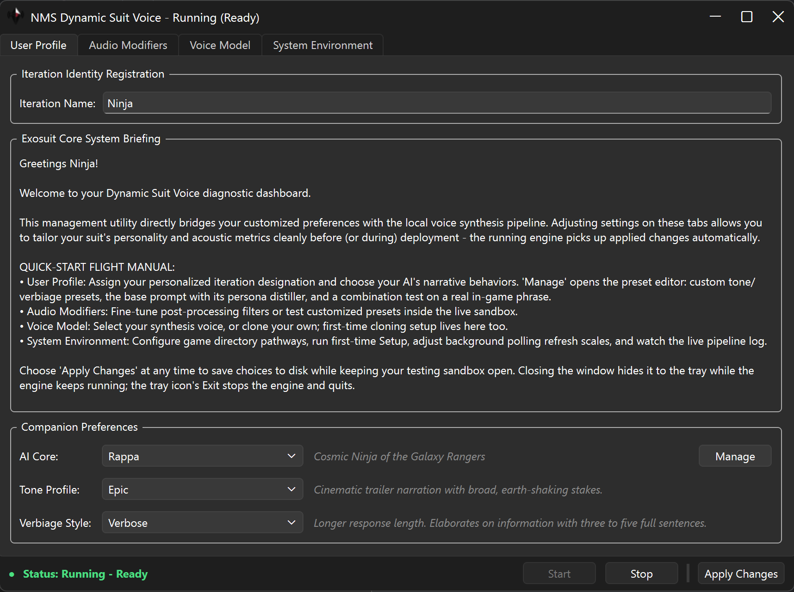

### What this fork changes

- [Pocket TTS](https://github.com/kyutai-labs/pocket-tts) replaces the old Coqui engine. 8 built-in voices to pick from, plus support for voice cloning (this is my main jam).
- Lines are generated by Gemma-4-E2B, replacing the old Qwen3 models.
- The manager UI is rebuilt in [PySide6](https://code.qt.io/cgit/pyside/pyside-setup.git/), replacing the old tkinter-based dashboard.
- Setup, voice picking, sound tuning, presets, and a live view of the engine all happen in the manager; removed old installation scripts.
- User editable prompt presets for tone and verbiage, plus a tester to see how any pairing generates with a real in-game phrase.
- Changing voice or tweaking audio parameters quietly re-records the affected lines in the background.
- Game path, voice, and other preferences stored in an untracked settings file that persists through updates.

  

Full guide: [docs/Guide.md](https://github.com/Kilvoctu/nms_dynamic_suit_voice_pocket_tts/blob/main/docs/Guide.md)

### Credits & license

Original mod by [Bob-Harper](https://github.com/Bob-Harper) ([nms_dynamic_suit_voice](https://github.com/Bob-Harper/nms_dynamic_suit_voice)). 
LLM [gemma-4-E2B-it-GGUF](https://huggingface.co/unsloth/gemma-4-E2B-it-GGUF) running in [llama-cpp-python](https://github.com/abetlen/llama-cpp-python), TTS voice [Pocket TTS](https://github.com/kyutai-labs/pocket-tts), processed with [ffmpeg](https://ffmpeg.org) and packed with [wav2wem](https://github.com/pas2k/wav2wem). The manager is built on [PySide6](https://code.qt.io/cgit/pyside/pyside-setup.git/).

MIT License, Copyright (c) 2025-2026 Bob Harper - see [LICENSE](LICENSE).
