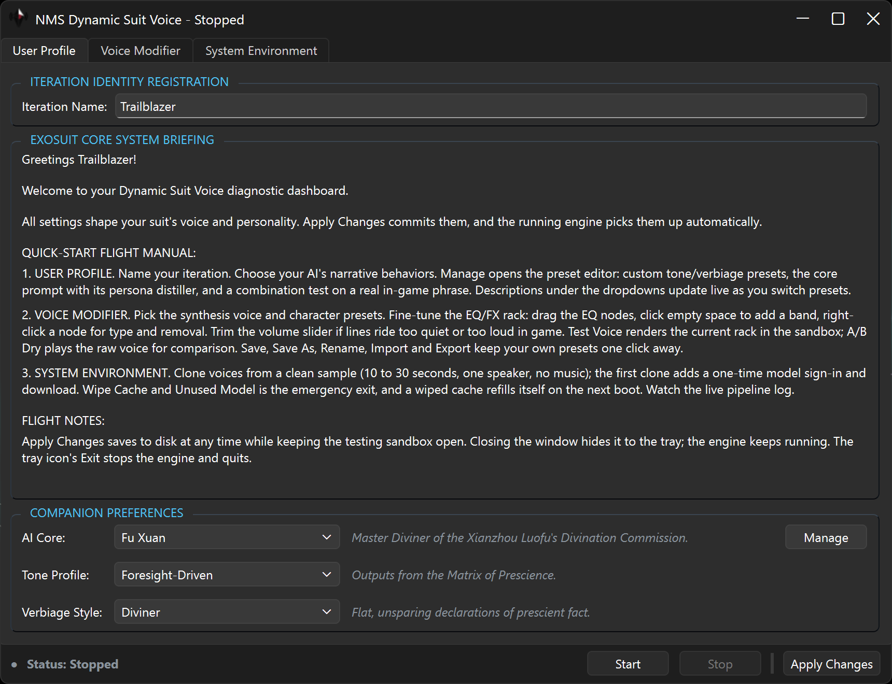
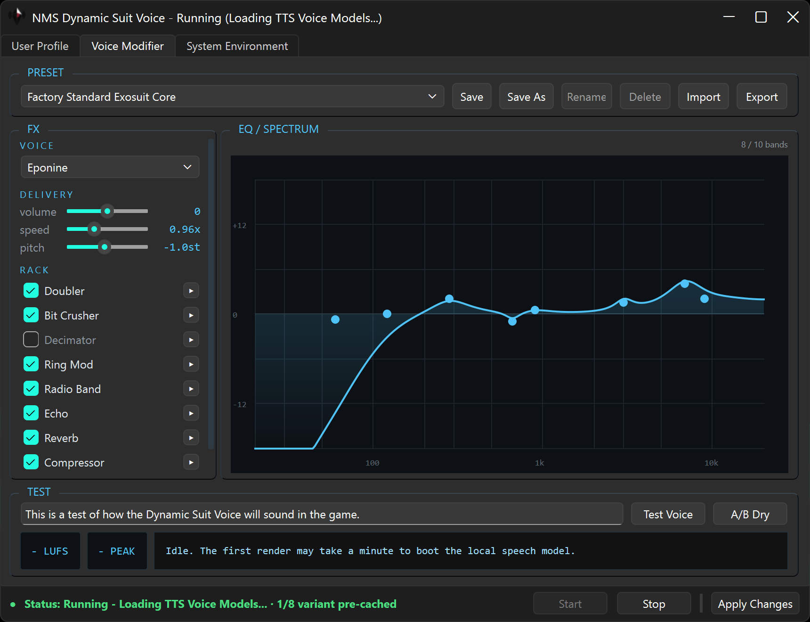

### What this fork changes
- [Pocket TTS](https://github.com/kyutai-labs/pocket-tts) replaces the old Coqui engine. 8 built-in voices to pick from, plus support for voice cloning (this is my main jam).
- Lines are generated by Gemma-4, replacing the old Qwen3 models.
- The manager UI is rebuilt in [PySide6](https://code.qt.io/cgit/pyside/pyside-setup.git/).
- Setup, voice picking, sound tuning, presets, and a live view of the engine all happen in the manager; removed old installation scripts.
- User editable prompt presets for tone and verbiage, plus a tester to see how the combination generates a real in-game phrase.
- DAW-style sound editor with EQ and FX rack, with live in-app testing.
- Changing parameters quietly re-records the affected lines in the background.
- Game path, voice, and other preferences stored in an untracked settings file that persists through updates.

  

  

### Requirements
- Windows 10/11
- Python 3.11, 3.12, or 3.13 (64-bit)
- Internet access for the one-time downloads (~4.5 GB total)

### Installation
1. Double-click **`run_manager.cmd`**. First run installs the dependencies into a virtual environment within the folder.
2. In **System Environment**, enter your No Man's Sky MODS directory (Setup offers to create it):
   - Steam (example): `C:/Program Files (x86)/Steam/steamapps/common/No Man's Sky/GAMEDATA/MODS/`
   - MS Store (example): `D:/XboxGames/No Man's Sky/Content/GAMEDATA/MODS/`
3. Press **Setup**. It finishes installing remaining dependencies and copies the mod files to your mods directory.
4. When it reports **Setup Complete**, close and restart the app, and all tabs unlock.

## Usage
The manager starts the voice engine automatically and shows live status in the bottom bar. Once it says **Ready**, you can
start No Man's Sky, and it will continue to generate variant lines in the background.

### User Profile
In this tab, you can enter your name and select the presets for rephrasing. Generated lines will use that name.
**Manage** opens the preset editor where you can duplicate a built-in or create your own. In there, **Combination Test** 
lets you test how any combination generates a real in-game phrase. If editing the **Core Prompt**, you can use 
**Distill Chat Persona...** and drop in a long chat persona such as a character card (JSON or TXT).
It'll create a summarized prompt to help get you started.

### Voice Modifier
This tab contains all the options for customizing voice; it includes settings for the voice model, a parametric EQ, 
an effects rack, buttons for testing. You can use the built-in presets or make and manage your own.

### Voice Cloning
Located in the **System Environment** tab. It uses a different Pocket TTS model, and you have to accept the Kyutai's 
(the developer) terms before cloning. Press **Sign in & Preload Model** to open a Hugging Face sign-in window. When you 
accept, it'll give an access token to paste in then it'll download the cloning model. The rest should be pretty 
self-explanatory. Just ensure to use a clean sample: one speaker, no music or background noise, 10-30 seconds, as a `.wav` file.

### Language Model
The default model is Gemma-4 E2B. If you have resources to spare, you can go to **Rephrasing model** under the 
**System Environment** tab and select the **E4B** model, which delivers wider variety and stronger flavor at ~3x the generation time. 
Swap on **Apply Changes** (generally this applies to any change you make); it'll download the model if needed.

### Miscellaneous
**Wipe Cache and Unused Model** erases cached voice variants, temp renders, and the Gemma 4 model that is *not* selected; useful to reclaim disk space.

Closing the manager window keeps the engine running. To close both, stop the engine first, then close the manager, or go 
the tray icon and select **Exit - stops the voice engine**, and it'll cleanly shut down the engine and manager.

Hover over anything in the manager for a tooltip, or just ask in [discussions](https://github.com/Kilvoctu/nms_dynamic_suit_voice_pocket_tts/discussions) and I'll be happy to answer any questions.
This is a personal fork so I was not too concerned about documentation.

### Uninstall
Remove the project directory and the `DYNAMIC_SUIT_VOICE` folder from the game's MODS directory. Nothing is installed anywhere else.

## Credits & license
Original mod by [Bob-Harper](https://github.com/Bob-Harper) ([nms_dynamic_suit_voice](https://github.com/Bob-Harper/nms_dynamic_suit_voice)). 
LLM [gemma-4-E2B-it-GGUF](https://huggingface.co/unsloth/gemma-4-E2B-it-GGUF) running in [llama-cpp-python](https://github.com/abetlen/llama-cpp-python), TTS voice [Pocket TTS](https://github.com/kyutai-labs/pocket-tts), processed and packed with [wav2wem](https://github.com/pas2k/wav2wem). The manager is built on [PySide6](https://code.qt.io/cgit/pyside/pyside-setup.git/).

MIT License, Copyright © 2025-2026 Bob Harper - see [LICENSE](LICENSE).
